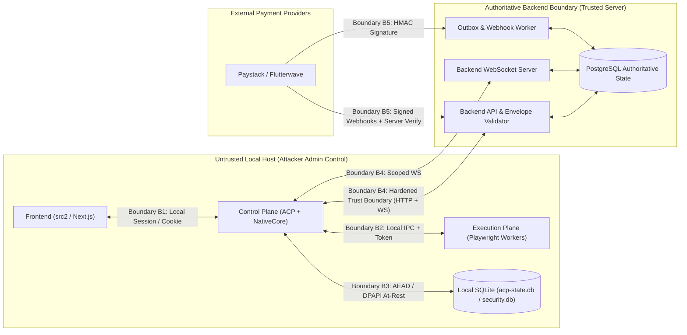

# 3. Security Threat Model (`SECURITY_THREAT_MODEL.md`)

---

## 1. Adversary Capabilities (Full Local Compromise Threat Model)

The system is designed and verified against an adversary who possesses **complete administrative control over their own local machine**, including the Automation Control Plane (CP), Execution Plane (EP), and local OS environment. Specifically, the adversary can:

1. **Inspect & Extract Local State**: Read all local files, `.env` configs, SQLite databases (`data/acp-state.db`, `data/security.db`), Windows DPAPI blobs belonging to the local Windows user, and in-memory secrets of local processes.
2. **Patch & Instrument Local Binaries**: Attach debuggers, hook V8/Node.js runtime functions, patch Bytenode `.jsc` loaders, or replace the NAPI-RS native addon (`acp_core.win32-x64-msvc.node`) on their own machine.
3. **Construct Arbitrary Network Requests**: Bypass the Next.js frontend and CP entirely to send handcrafted HTTP/REST requests, v2 signed envelopes, and WebSocket frames directly to `bettingAutomationBackend`.
4. **Manipulate Local Clocks & Envelopes**: Forge timestamps, omit optional fields (`sessionId`, `clientGeneration`), replay historical envelopes, or reuse payment references across endpoints.

### Capabilities Not Granted to the Adversary
- The adversary **cannot** compromise the remote Backend server or its PostgreSQL database directly.
- The adversary **cannot** forge Ed25519 signatures under the Backend's `KMS_MASTER_SEED` / `KEYGEN_PUBLIC_KEY` private keys or break AES-256-GCM / Argon2id cryptography.
- The adversary **cannot** intercept another tenant's network traffic or read another tenant's local machine state unless a Backend vulnerability leaks it across the network.

---

## 2. Trust Boundaries

### Primary Security Invariant (Boundary B4)
**Local compromise of Tenant $A$'s machine must never yield:**
1. Access to or mutation of Tenant $B$'s accounts, sessions, machines, configurations, telemetry, or support channels.
2. Unpaid subscription activation, plan upgrades, or multi-redemption of a single payment transaction.
3. Continued access to Backend domain APIs, session renewals, execution leases, or WebSocket streams after Tenant $A$'s account, license, machine, or session is expired or revoked.
4. Bypass of server-enforced plan entitlements (e.g., `maxMachines`, `maxAccounts`).

---

## 3. Secondary Defense-in-Depth Boundary (Boundary B3: Local Storage)
While a live root/admin process debugger on the local machine can ultimately observe credentials at the moment EP logs into a bookmaker site, **passive disk compromises** (stolen backups, crash dumps, unencrypted SQLite file exfiltration, or local read-only malware) must not expose cleartext bookmaker credentials in `acp-state.db`. All persisted bookmaker passwords in `accounts_metadata_cache` must be encrypted at rest using AES-256-GCM bound to the local hardware/DPAPI key material.
