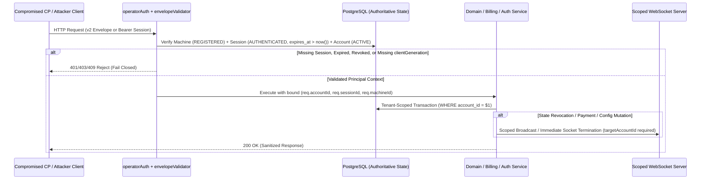

# 5. Target Security Architecture (`TARGET_SECURITY_ARCHITECTURE.md`)

---

## 1. Architectural Principles

1. **Authoritative Backend Enforcement**: All security invariants—authentication, account status (`ACTIVE`), machine registration status (`REGISTERED`), session liveness (`AUTHENTICATED` and `expires_at > now()`), monotonic generation fencing, license validity, and multi-tenant scoping—are enforced authoritatively by `bettingAutomationBackend` on every request.
2. **Single Canonical Principal Context (`req.accountId`, `req.sessionId`, `req.machineId`)**: No domain route (`src/api/routes/*.mjs`) may ever execute without a verified `req.accountId` bound to an `ACTIVE` account and a live `AUTHENTICATED` session.
3. **Strict Multi-Tenant Partitioning**: Every database query, configuration mutation, machine revocation, and WebSocket broadcast is explicitly scoped by `account_id`. Shared defaults (`global_automation_configs WHERE id = 'primary'`) are read-only templates; tenant mutations write exclusively to `id = accountId`.
4. **One-Time Canonical Payment Redemption**: Every provider payment transaction is locked and recorded under both its canonical provider transaction ID (`tx.data.id`) and provider reference (`tx.data.tx_ref` / `tx.data.reference`). Any subsequent attempt to redeem either identifier fails closed with `409 Conflict` (`PAYMENT_ALREADY_REDEEMED`).
5. **Immediate Revocation Propagation**: Revoking an account, license, machine, or session atomically invalidates database state, increments monotonic generation counters (`session_generation`, `revoke_generation`, `license_revision`), emits a tenant-scoped outbox event, and immediately terminates matching active WebSocket connections.

---

## 2. Target Security Enforcement Pipeline

---

## 3. Component Responsibilities Across Repositories

| Component | Authoritative Security Responsibility | Explicitly Untrusted / Never Assumed |
|---|---|---|
| **Backend (`bettingAutomationBackend`)** | Root of trust for identity, sessions, machine seat limits, payment verification, license issuance, generation counters, and multi-tenant data isolation. | Never trusts client-supplied `accountId`, unverified `envelope.machineId`, client-computed plan prices, or unverified webhook email fields. |
| **Control Plane (`bettingAutomationControlPlane`)** | Local orchestrator enforcing Ed25519 signature verification of Backend responses/offline kits via Rust `NativeCore`, AEAD encryption of local SQLite secrets (`AccountsAdapter`), and authenticated IPC to EP. | Never trusted by Backend to self-enforce tenant boundaries or license validity for Backend API operations. |
| **Execution Plane (`bettingAutomation`)** | Headless browser worker accepting commands only over localhost IPC authenticated via 256-bit `ACP_IPC_TOKEN` (`X-ACP-IPC-Token`). | Contains zero Backend credentials or global secrets; cannot escalate privileges against Backend. |
| **Frontend (`betting-automation-frontend`)** | Operator UI (`src2/`) communicating with CP via `httpOnly` session cookies and backend sync proxy. | Pure presentation layer; possesses zero authoritative security bypasses. |
